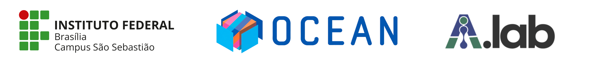

# 🚀 Repositório de Disciplinas e Códigos-Fonte

Materiais didáticos, códigos de exemplo, notebooks, datasets e projetos utilizados nas disciplinas e atividades acadêmicas do professor **Eduardo Camargo de Siqueira**.

Este repositório reúne conteúdos de programação, inteligência artificial, desenvolvimento web, desenvolvimento móvel e informática aplicada, com foco em ensino, experimentação e apoio a projetos acadêmicos.

  

## ✨ Sobre o Autor

Eduardo Camargo de Siqueira é professor de Tecnologia da Informação no [IFB - Campus São Sebastião](https://www.ifb.edu.br/saosebastiao), com atuação em ensino, pesquisa, inovação, extensão e gestão acadêmica.

Possui graduação em Ciência da Computação pela Universidade Evangélica de Goiás, mestrado e doutorado em Modelagem Matemática e Computacional pelo CEFET-MG, e realiza pós-doutorado na Universidade de Brasília (UnB), com foco em inteligência artificial aplicada.

Atua como pesquisador no [AILAB - UnB](https://ailab.unb.br/), participando de projetos de pesquisa e desenvolvimento relacionados a IA aplicada em saúde digital, justiça, automação de processos, processamento de linguagem natural, extração de informações em documentos e apoio à tomada de decisão.

Também integra iniciativas de capacitação tecnológica e empreendedora no âmbito do Samsung Ocean, contribuindo para a formação de profissionais e para o desenvolvimento de soluções inovadoras.

## 🛠️ Conteúdo do Repositório

| Área | Descrição |
| --- | --- |
| [Inteligência Artificial](inteligencia-artificial/) | Aulas, notebooks, experimentos e materiais sobre IA e aprendizado de máquina. |
| [Programação Web](programacao-web/) | Projetos e exemplos com HTML, CSS, JavaScript, Flask e APIs. |
| [Programação Móvel](programacao-movel/) | Projetos e protótipos relacionados ao desenvolvimento de aplicações móveis. |
| [Outras Atividades](outras/) | Notebooks, datasets e materiais complementares para aulas e projetos. |

## 💻 Disciplinas

- Inteligência Artificial
- Programação Web
- Programação Móvel
- Sistemas Computacionais
- Informática aplicada

## 💡 Linhas de Pesquisa

- **Machine Learning**: transformação de dados em conhecimento por meio de modelos computacionais.
- **Inteligência Computacional para Otimização**: métodos inteligentes para apoiar decisões e melhorar resultados.
- **Otimização Combinatória**: busca por soluções eficientes em problemas com muitas possibilidades.
- **Digital Health**: aplicação de tecnologias da informação e comunicação no contexto da saúde.
- **Processamento de Linguagem Natural**: análise, extração e organização de informações em textos e documentos.

## 🔥 Links

- [Currículo Lattes](http://lattes.cnpq.br/1383558830607731)
- [GitLab](https://gitlab.com/ecsiqueira35)
- [Site pessoal](https://duca.pro.br)
- [YouTube](https://www.youtube.com/channel/UCSopjE1rnNcg175Wb0acHzw)
- [Instagram](http://instagram.com/profduca)
- [Email](mailto:eduardo.siqueira@ifb.edu.br)

## 🛠️ Como Usar

Navegue pelas pastas de acordo com a disciplina ou tema de interesse. Cada diretório pode conter seus próprios arquivos `README.md`, notebooks, datasets, projetos e instruções específicas.

Os materiais podem ser utilizados em estudos, aulas, práticas de laboratório e projetos acadêmicos. Quando houver dependências específicas, consulte o `README.md` do projeto correspondente ou os arquivos `requirements.txt`.

## ❤️ Contribuição

Se você deseja contribuir com novos códigos, notebooks ou datasets para este repositório, sinta-se à vontade para abrir uma pull request. Teremos prazer em revisar suas contribuições. Se você encontrar algum erro ou tiver alguma dúvida, envie um e-mail: eduardo.siqueira@ifb.edu.br. Obrigado por contribuir e espero que você aprenda bastante com este material!

## 📄 Licença

É permitida a utilização, cópia, modificação, mesclagem, publicação e distribuição deste material, gratuitamente, para fins pessoais e/ou didáticos.

**A venda total ou parcial deste material é proibida.**

---

⌨️ Desenvolvido por [Duca Siqueira](https://duca.pro.br).

❤️ Instagram: [@profduca](https://instagram.com/profduca).

